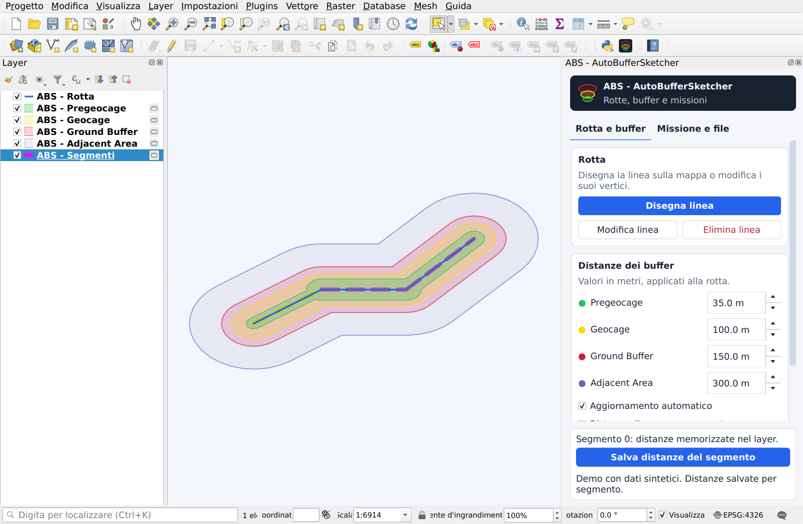

# ABS - AutoBufferSketcher

**Disegna una rotta. Definisci le distanze. Aggiorna i buffer mentre lavori in QGIS.**

ABS è un progetto personale di **Francesco Rosano** per disegnare e modificare rotte, generare quattro fasce di buffer e gestire distanze uniformi oppure diverse per ogni segmento.

*QGIS plugin for interactive route sketching, four metric buffer zones, per-segment distances, GeoPackage persistence, GeoJSON and `.plan` export.*

**Stato:** versione di sviluppo 0.2.0, sperimentale. Il plugin non è ancora pubblicato nel catalogo ufficiale QGIS. L’interfaccia è in italiano.

Tutte le immagini usano la [rotta sintetica inclusa](examples/README.md), senza dati operativi o servizi cartografici esterni.

[Guida completa](docs/USER_GUIDE.md) · [Demo riproducibile](examples/README.md) · [Changelog](CHANGELOG.md) · [Contribuire](CONTRIBUTING.md)

## Cosa puoi fare

- Disegnare rotte sulla mappa, modificare i vertici ed eliminare le linee con conferma.
- Generare **Pregeocage**, **Geocage**, **Ground Buffer** e **Adjacent Area**, con distanze in metri e aggiornamento automatico o manuale.
- Salvare quattro distanze indipendenti per ciascun segmento; conservarle durante divisioni compatibili e gestire esplicitamente le fusioni con valori diversi.
- Salvare rotta, buffer e segmenti in GeoPackage e ripristinare modalità e parametri dal progetto QGIS.
- Esportare GeoJSON in WGS84 e piani `.plan` per il flusso RigiCloud, entro i limiti documentati.

## Installazione

Il plugin usa Python, Qt e PyQGIS forniti con QGIS; non richiede pacchetti Python esterni.

**Da ZIP:** quando hai un pacchetto del plugin, apri **Plugin → Gestisci e installa plugin → Installa da ZIP**, selezionalo e abilita ABS. Dopo un aggiornamento, riavvia QGIS per ricaricare il codice Python.

**Dal sorgente:** apri **Impostazioni → Profili utente → Apri cartella del profilo attivo** e copia `auto_buffer_sketcher` dentro `python/plugins`. Riavvia QGIS e abilita **ABS - AutoBufferSketcher** dal gestore plugin. Per le versioni di sviluppo usa un profilo separato.

Il minimo dichiarato è QGIS 3.34; le verifiche disponibili riguardano **QGIS 3.34.4 e 3.44.15 su Linux**. La versione è destinata a QGIS 3.x; QGIS 4, Windows e macOS non sono ancora convalidati.

## Primo utilizzo

1. Apri ABS dalla toolbar. Nella scheda **Rotta e buffer**, imposta le quattro distanze.
2. Premi **Disegna linea**: clic sinistro per aggiungere vertici, clic destro per completare, Backspace per rimuovere l’ultimo vertice, Esc per annullare.
3. Usa **Modifica linea** e poi **Salva modifiche** per intervenire sui vertici. L’aggiornamento automatico è inizialmente attivo; puoi usare anche **Ricalcola buffer**.
4. Per distanze locali, attiva **Distanze diverse per segmento**, seleziona un segmento sulla mappa, imposta i valori e premi **Salva distanze del segmento**. Poi passa al successivo.
5. Nella scheda **Missione e file**, scegli il formato di esportazione o rendi persistenti i layer. Salva anche il progetto QGIS per conservarne impostazioni e riferimenti.

## Salvataggi ed esportazioni

| Azione | Risultato |
| --- | --- |
| Salva distanze del segmento | Memorizza i quattro valori soltanto nel segmento selezionato del layer corrente. |
| Applica a tutti i segmenti | Sostituisce le distanze di tutti i segmenti con i valori correnti. |
| Esporta GeoPackage | Esporta rotta e quattro buffer. Non include il layer dei segmenti. |
| Rendi layer persistenti | Salva anche i segmenti e sostituisce nel progetto i layer temporanei con quelli su disco. |
| Esporta GeoJSON | Esporta rotte, waypoint e buffer in WGS84, comprese geometrie multipart e anelli interni. |
| Esporta .plan | Esporta una rotta rappresentabile con i suoi buffer e i parametri di missione. |

La [guida d’uso](docs/USER_GUIDE.md) spiega la differenza fra salvare valori, salvare layer e salvare il progetto.

## Limiti e compatibilità

- Calcolo metrico regionale in un CRS UTM locale: estensioni oltre 6° in longitudine o latitudine, attraversamenti dell’antimeridiano e latitudini fuori da 80° S–84° N sono segnalati come non supportati.
- `.plan` richiede una rotta continua con almeno tre vertici. Parti separate, buchi e buffer non rappresentabili vengono segnalati; GeoJSON conserva invece le geometrie complete.
- **La compatibilità completa con RigiCloud 1.19.9 resta in validazione**, comprese quote, profilo e parametri. Un file JSON leggibile non dimostra l’accettazione della missione nel sistema target.
- I valori iniziali sono parametri del software, non una verifica dell’adeguatezza di una missione.

## Qualità e sviluppo

La suite contiene **37 regressioni del plugin e 7 prove dell’interfaccia**, oltre allo smoke test degli esportatori. GitHub Actions le esegue con il Python di sistema e Qt offscreen. Le verifiche offscreen non coprono ogni interazione desktop o piattaforma.

Il codice è in `auto_buffer_sketcher/`; i test sintetici sono in `tests/`. Per riprodurli o proporre una modifica, vedi [CONTRIBUTING.md](CONTRIBUTING.md). Per un problema, apri una segnalazione con il modello dedicato nella sezione Issues della repository, indicando versioni, CRS e passaggi riproducibili.

## Autore e licenza

**Francesco Rosano** — progetto personale. Contatto tramite le Issues della repository.

Distribuito con licenza **GNU GPL versione 3 (GPL-3.0-only)**. Sono consentiti anche uso e distribuzione commerciali, nel rispetto della licenza. Vedi [LICENSE](LICENSE) e [NOTICE](NOTICE). La pubblicazione nel catalogo resta in preparazione; il contatto autore nei metadati è rosano_francesco@hotmail.it.

## Progetti precedenti

I layer standard con nomi `ABC` continuano a essere riconosciuti. I nomi predefiniti passano al prefisso **ABS**, conservando file sorgente e nomi personalizzati. Il pacchetto Python mantiene l’identificatore `auto_buffer_sketcher`.
