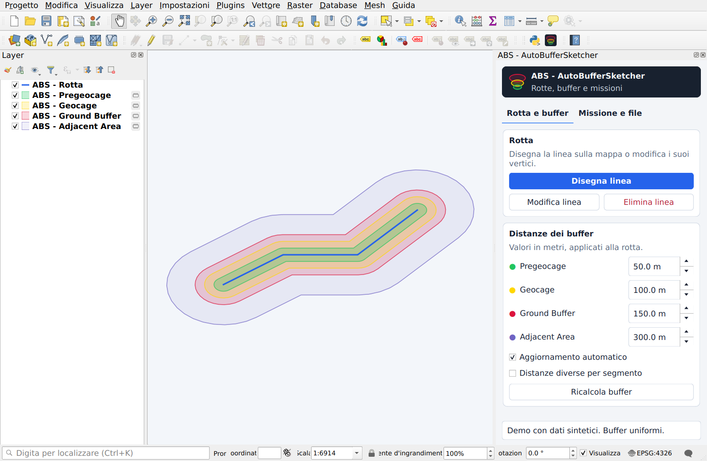

# ABS - AutoBufferSketcher

[Italiano](#italiano) · [English](#english)

## Italiano

### Il progetto

Sto sviluppando ABS come progetto personale per disegnare e modificare rotte in QGIS e gestire quattro fasce di buffer, con distanze uniformi oppure diverse per ogni segmento. Ho portato questo progetto anche nella mia tesina di fine corso.

Con ABS voglio raccogliere nello stesso pannello il lavoro sulla rotta, il calcolo dei buffer e la preparazione dei dati da esportare. Per lo scambio GIS metto a disposizione GeoPackage e GeoJSON; per il flusso missione ho un’esportazione `.plan` pensata appositamente per **RigiCloud**.

**Stato:** ho pubblicato la versione sperimentale [0.2.5](https://github.com/OnlyPio59/ABS_AutoBufferSketcher/releases/tag/v0.2.5), con versione visibile nel pannello. ABS è approvato e disponibile nel [catalogo ufficiale QGIS](https://plugins.qgis.org/plugins/auto_buffer_sketcher/), come plugin sperimentale. Nel sorgente corrente ho completato l’interfaccia italiana e inglese: segue la lingua di QGIS, con italiano come ripiego. Lo ZIP 0.2.5 include entrambe le lingue; le altre lingue restano da valutare.

[Guida completa](docs/USER_GUIDE.md) · [Demo riproducibile](examples/README.md) · [Presentazione breve](docs/DEMO.md#italiano) · [Changelog](CHANGELOG.md) · [Contribuire](CONTRIBUTING.md)

La 0.2.5 corregge soltanto cinque nomi di variabili locali; funzioni, interfaccia e formati restano invariati.

**Demo video — 50 secondi:** [guarda o scarica la versione italiana](https://github.com/OnlyPio59/ABS_AutoBufferSketcher/releases/download/v0.2.4/ABS_demo_0.2.4_IT_r1.mp4). Mostro la modifica della rotta, il salvataggio indipendente delle distanze e gli export, con schermate QGIS e dati sintetici. La demo è realizzata con la 0.2.4 e mostra lo stesso flusso della 0.2.5.

### Da dove nasce

Ho creato ABS partendo da una difficoltà concreta nella pianificazione delle rotte: nel mio flusso di lavoro con RigiCloud, correggere un tratto poteva richiedere di riposizionare manualmente anche molti punti delle fasce associate. Volevo poter intervenire su singoli vertici e adattare le distanze lungo il percorso mantenendo il controllo della geometria complessiva.

Ho quindi portato questo lavoro in QGIS: modifico la rotta, ricalcolo i buffer e posso impostare distanze diverse per segmento. Nel flusso che ho descritto nella mia tesina, esportavo poi il `.plan` e lo importavo in RigiCloud, dove rifinivo quote e geocage. È da questa esigenza che nasce l’esportazione dedicata: ABS si concentra sul lavoro geometrico e prepara il passaggio alla piattaforma di pianificazione.

### Cosa posso fare con ABS

- Disegnare rotte sulla mappa, modificare i vertici ed eliminare linee con conferma.
- Generare **Pregeocage**, **Geocage**, **Ground Buffer** e **Adjacent Area** in metri, con aggiornamento automatico o manuale.
- Salvare distanze indipendenti per ciascun segmento e ritrovarle passando da un segmento all’altro.
- Rendere persistenti i layer e conservare modalità e parametri nel progetto QGIS.
- Esportare geometrie GIS oppure un profilo missione `.plan` dedicato a RigiCloud, entro i limiti documentati.

### Installazione e primo utilizzo

Uso Python, Qt e PyQGIS già forniti con QGIS, senza pacchetti Python esterni. Dichiaro QGIS **3.34–3.99**; le verifiche disponibili riguardano **3.34.4 e 3.44.15 su Linux**. Non ho ancora convalidato Windows, macOS o QGIS 4.

1. In QGIS apri **Plugin → Gestisci e installa plugin → Impostazioni** e abilita **Mostra anche plugin sperimentali**.
2. Nella scheda **Tutti**, cerca **ABS - AutoBufferSketcher** e premi **Installa plugin**. In alternativa, scarica lo ZIP dagli asset della [release](https://github.com/OnlyPio59/ABS_AutoBufferSketcher/releases/tag/v0.2.5) e usa **Installa da ZIP**. Dopo un aggiornamento, riavvia QGIS.
3. Apri ABS dalla toolbar. In **Rotta e buffer** imposta le distanze e premi **Disegna linea**: clic sinistro per i vertici, clic destro per completare, Backspace per rimuovere l’ultimo vertice, Esc per annullare.
4. Usa **Modifica linea** e **Salva modifiche** per intervenire sui vertici. Puoi disattivare l’aggiornamento automatico e usare **Ricalcola buffer**.
5. Per valori locali, attiva **Distanze diverse per segmento**, seleziona un segmento, modifica i campi e premi **Salva distanze del segmento** prima di selezionare il successivo.

Per lavorare dal sorgente, copia `auto_buffer_sketcher` in `python/plugins` del profilo QGIS e riavvia l’applicazione. Per lo sviluppo consiglio un profilo separato.

### Salvare ed esportare

| Azione | Cosa ottengo |
| --- | --- |
| Salva distanze del segmento | I quattro valori memorizzati soltanto nel segmento selezionato del layer corrente. |
| Applica a tutti i segmenti | Gli stessi valori correnti su tutti i segmenti. |
| Esporta GeoPackage | Una copia di rotta e quattro buffer, senza il layer segmenti. |
| Rendi layer persistenti | Rotta, buffer e segmenti su disco; salvo poi anche il progetto QGIS. |
| Esporta GeoJSON | Rotte, waypoint e buffer in WGS84, comprese parti separate e anelli interni. |
| Esporta .plan per RigiCloud | Una rotta e i buffer associati nel profilo missione dedicato implementato da ABS. |

Il pulsante del segmento salva nel layer corrente: per conservare layer temporanei dopo la chiusura uso **Rendi layer persistenti** e salvo il progetto QGIS.

### Perché specifico RigiCloud

Il `.plan` che esporto contiene una missione VTOL, un profilo e parametri di sicurezza e i geofence. Lo considero un’esportazione dedicata al flusso **RigiCloud**, non un piano universale compatibile con qualunque applicazione. Ho verificato il funzionamento del file esportato nel mio ambiente **RigiCloud 1.19.9**. Questa prova pratica riguarda il flusso che utilizzo e non estende la compatibilità ad altri formati o a ogni possibile configurazione di missione.

Non ho ancora implementato un secondo esportatore missione generico. Per aggiungerlo dovrò prima scegliere l’applicazione destinataria e il suo schema: la stessa estensione `.plan` è usata anche da formati differenti. GeoJSON e GeoPackage rimangono le mie opzioni di scambio delle geometrie GIS.

### Limiti e verifiche

Calcolo i buffer in un CRS UTM locale: estensioni oltre 6° in longitudine o latitudine, attraversamenti dell’antimeridiano e latitudini fuori da 80° S–84° N sono segnalati come non supportati. Il profilo `.plan` attuale richiede una rotta continua con almeno tre vertici e rifiuta geometrie non rappresentabili, come parti separate o buchi. I valori iniziali sono parametri del software, non una validazione di una missione.

Mantengo **39 regressioni funzionali, 9 prove dell’interfaccia, 7 prove di confezionamento, 9 prove del sistema di traduzione, 2 prove della versione caricata e 4 prove dei flussi bilingui (ripetute anche con scala 150%)**, oltre allo smoke test degli esportatori. Le eseguo anche su GitHub Actions. Ho verificato l’installazione ZIP in un profilo QGIS isolato; le prove offscreen non coprono ogni interazione desktop o piattaforma.

Per le immagini e la [demo](examples/README.md) uso soltanto dati sintetici. La guida dettagliata è disponibile in [italiano](docs/USER_GUIDE.md) e [inglese](docs/USER_GUIDE.en.md). Per una segnalazione o una proposta, usa i modelli nella sezione Issues.

Dopo aver eliminato una rotta modificata, può restare temporaneamente un tratteggio sulla mappa: uno zoom lo rimuove. Mantengo aperto questo difetto grafico.

### Licenza

Distribuisco ABS con **GPL-3.0-only**, che consente anche uso commerciale nel rispetto delle sue condizioni. Il mio contatto è **rosano_francesco@hotmail.it**. Attribuzione e testo completo sono in [NOTICE](NOTICE) e [LICENSE](LICENSE).

Mantengo la compatibilità con i layer storici `ABC` e con i nomi personalizzati; l’identificatore Python resta `auto_buffer_sketcher`.

---

## English

### The project

I am developing ABS as a personal project to draw and edit routes in QGIS and manage four buffer zones, with uniform distances or different values for each segment. I also presented this project in my end-of-course thesis.

With ABS, I want to bring route editing, buffer calculation and export preparation into the same panel. I provide GeoPackage and GeoJSON for GIS data exchange, and a `.plan` mission export designed specifically for the **RigiCloud** workflow.

**Status:** I have published experimental version [0.2.5](https://github.com/OnlyPio59/ABS_AutoBufferSketcher/releases/tag/v0.2.5), with a visible version badge. ABS is approved and available in the [official QGIS plugin catalog](https://plugins.qgis.org/plugins/auto_buffer_sketcher/), as an experimental plugin. In the current source, I have completed the Italian and English interface: it follows the QGIS language, with Italian as fallback. The 0.2.5 ZIP includes both languages; further languages remain to be considered.

[Detailed guide](docs/USER_GUIDE.en.md) · [Reproducible demo — Italian](examples/README.md) · [Short presentation](docs/DEMO.md#english) · [Changelog](CHANGELOG.md) · [Contributing](CONTRIBUTING.md)

Version 0.2.5 only improves five local variable names; functionality, interface and formats remain unchanged.

**Video demo — 50 seconds:** [watch or download the English version](https://github.com/OnlyPio59/ABS_AutoBufferSketcher/releases/download/v0.2.4/ABS_demo_0.2.4_EN_r1.mp4). I show route editing, independent segment-distance saving and exports using English QGIS screenshots and synthetic data. The demo uses 0.2.4 and shows the same workflow as 0.2.5.

### Where it started

I created ABS to address a practical difficulty in route planning: in my RigiCloud workflow, correcting a section of a route could also require manually repositioning many points in the associated zones. I wanted to edit individual vertices and adjust distances along the route while keeping control of the overall geometry.

I moved this work into QGIS, where I can edit the route, recalculate its buffers and set different distances for each segment. In the workflow I described in my thesis, I then exported the `.plan` and imported it into RigiCloud, where I refined altitudes and geocage settings. This is why the dedicated export exists: ABS focuses on geometry editing and prepares the handoff to the planning platform.

### What I can do with ABS

- Draw routes on the map, edit vertices and delete lines with confirmation.
- Generate **Pregeocage**, **Geocage**, **Ground Buffer** and **Adjacent Area** in metres, with automatic or manual updates.
- Save independent distances for each segment and retrieve them when switching between segments.
- Save temporary layers to disk and preserve modes and parameters in the QGIS project.
- Export GIS geometries or a dedicated RigiCloud `.plan` mission profile, within the documented limits.

### Installation and first use

I use the Python, Qt and PyQGIS components shipped with QGIS, without additional Python packages. I declare support for QGIS **3.34–3.99**; the available checks cover **3.34.4 and 3.44.15 on Linux**. I have not yet validated Windows, macOS or QGIS 4.

1. In QGIS, open **Plugins → Manage and Install Plugins → Settings** and enable **Show also experimental plugins**.
2. In **All**, search for **ABS - AutoBufferSketcher** and click **Install Plugin**. Alternatively, download the ZIP asset from the [release](https://github.com/OnlyPio59/ABS_AutoBufferSketcher/releases/tag/v0.2.5) and use **Install from ZIP**. Restart QGIS after an update.
3. Open ABS from its toolbar button. In **Route / buffers** (**Rotta e buffer** in Italian), set the distances and click **Draw line** (**Disegna linea**): left-click to add vertices, right-click to finish, Backspace to remove the last vertex and Esc to cancel.
4. Use **Edit line** (**Modifica linea**) and **Save changes** (**Salva modifiche**) to edit vertices. You can disable automatic updates and use **Recalculate buffers** (**Ricalcola buffer**).
5. For local values, enable **Per-segment distances** (**Distanze diverse per segmento**), select a segment, change the values and click **Save segment distances** (**Salva distanze del segmento**) before selecting the next segment.

To work from source, copy `auto_buffer_sketcher` into the QGIS profile’s `python/plugins` directory and restart the application. I recommend a separate profile for development.

### Saving and exporting

| Action | What I get |
| --- | --- |
| Save segment distances | The four values stored only on the selected segment in the current layer. |
| Apply to all segments | The current values applied to every segment. |
| Export GeoPackage | A copy of the route and four buffers, without the segments layer. |
| Make layers persistent | Route, buffers and segments saved to disk; I also save the QGIS project afterwards. |
| Export GeoJSON | Routes, waypoints and buffers in WGS84, including multipart geometries and inner rings. |
| Export .plan for RigiCloud | One route and its associated buffers in the dedicated mission profile implemented by ABS. |

The segment button saves values in the current layer. To retain temporary layers after closing QGIS, I use **Rendi layer persistenti** (Make layers persistent) and save the QGIS project.

### Why I specify RigiCloud

The `.plan` I export contains a VTOL mission, a safety profile and settings, and geofences. I treat it as a dedicated export for the **RigiCloud** workflow, not a universal mission plan compatible with every application. I have verified that the exported file works in my **RigiCloud 1.19.9** environment. This practical check covers my workflow and does not extend compatibility to other formats or every possible mission configuration.

I have not yet implemented a second generic mission exporter. Before adding one, I will need to choose its destination application and schema: the `.plan` extension is also used by different formats. GeoJSON and GeoPackage remain my options for exchanging GIS geometries.

### Limits and checks

I calculate buffers in a local UTM CRS. Extents greater than 6° in longitude or latitude, antimeridian crossings and latitudes outside 80° S–84° N are reported as unsupported. The current `.plan` profile requires a single continuous route with at least three vertices and rejects unrepresentable geometries such as separate parts or holes. Initial values are software parameters, not mission validation.

I maintain **39 functional regressions, 9 interface checks, 7 packaging checks, 9 translation-system checks, 2 loaded-version checks and 4 bilingual workflow checks (also repeated at 150% scale)**, plus the exporter smoke tests, and run them through GitHub Actions. I have checked ZIP installation in an isolated QGIS profile; offscreen checks do not cover every desktop interaction or platform.

I use only synthetic data for the screenshots and [demo](examples/README.md). The detailed guide is available in [English](docs/USER_GUIDE.en.md) and [Italian](docs/USER_GUIDE.md). For a bug report or proposal, use the repository’s issue templates.

After deleting an edited route, a dashed overlay may remain on the map until a zoom refresh. I am tracking this remaining visual issue.

### License

I distribute ABS under **GPL-3.0-only**, which also permits commercial use under its terms. My contact address is **rosano_francesco@hotmail.it**. See [NOTICE](NOTICE) for attribution and [LICENSE](LICENSE) for the full terms.

I preserve compatibility with historical `ABC` layer names and custom titles; the Python package identifier remains `auto_buffer_sketcher`.
