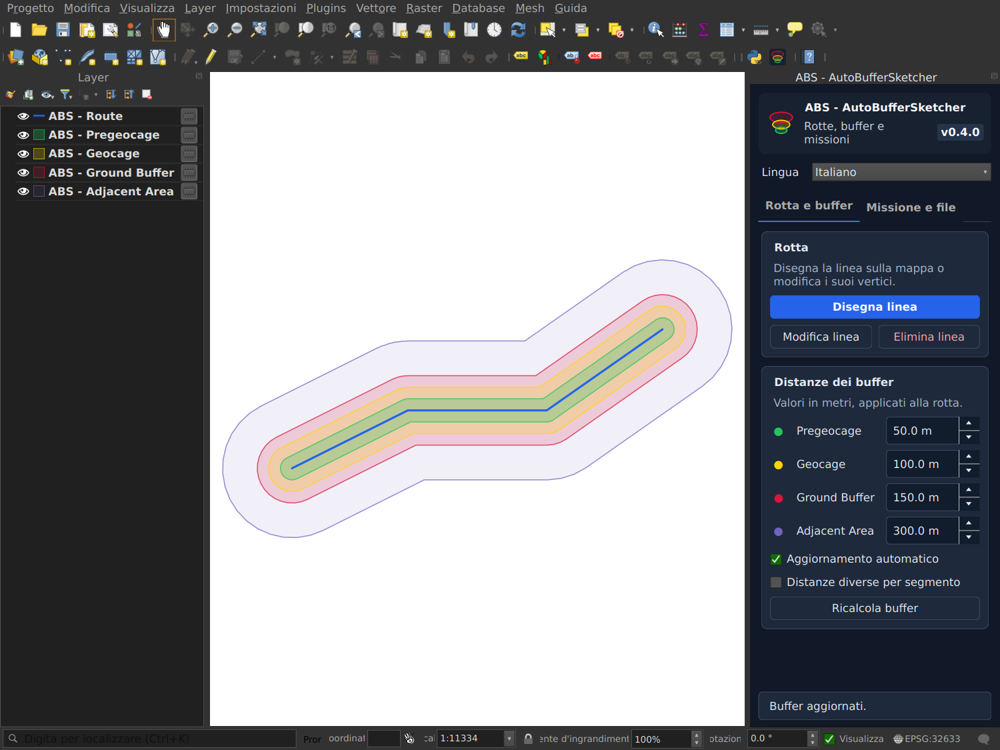
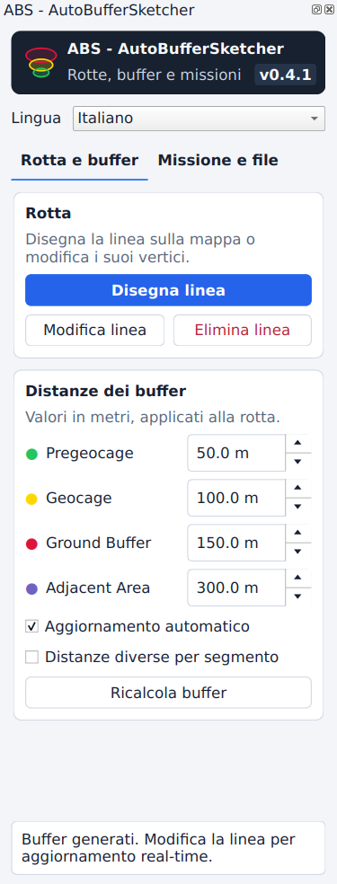
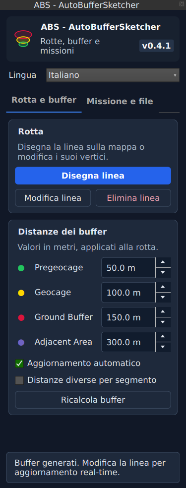
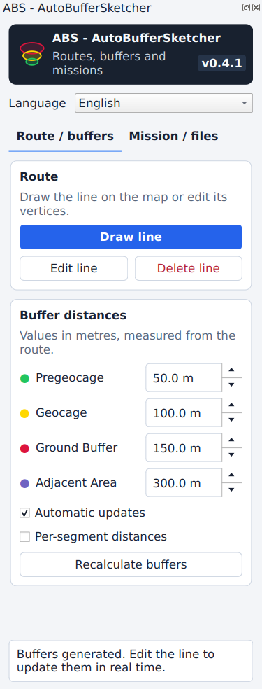
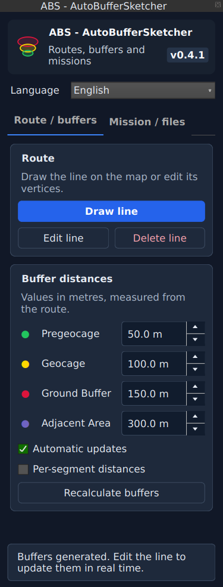

# ABS - AutoBufferSketcher

[Italiano](#italiano) · [English](#english)

## Italiano

### Il progetto

Sto sviluppando ABS come progetto personale per disegnare e modificare rotte in QGIS e gestire quattro fasce di buffer, con distanze uniformi oppure diverse per ogni segmento. Ho portato questo progetto anche nella mia tesina di fine corso.

Con ABS voglio raccogliere nello stesso pannello il lavoro sulla rotta, il calcolo dei buffer e la preparazione dei dati da esportare. Per lo scambio GIS metto a disposizione GeoPackage e GeoJSON; per il flusso missione ho un’esportazione `.plan` per le missioni.

**Stato:** ho pubblicato la [0.4.0](https://github.com/OnlyPio59/ABS_AutoBufferSketcher/releases/tag/v0.4.0), **approvata e disponibile nel [catalogo ufficiale QGIS](https://plugins.qgis.org/plugins/auto_buffer_sketcher/)** come versione sperimentale. Include sei lingue e compatibilità QGIS 3/4. La scansione sicurezza/qualità è passata 5/5 senza rilievi; ho verificato anche l’installazione dal catalogo in un profilo QGIS pulito.

[Guida completa](docs/USER_GUIDE.md) · [Demo riproducibile](examples/README.md) · [Presentazione breve](docs/DEMO.md#italiano) · [Changelog](CHANGELOG.md) · [Contribuire](CONTRIBUTING.md)

Nella 0.4.0 mantengo la compatibilità QGIS 3/4 e Qt5/Qt6 e aggiungo sei lingue: italiano, inglese, spagnolo, portoghese brasiliano, francese e tedesco. Dal selettore sotto il logo posso seguire automaticamente la lingua di QGIS oppure scegliere una lingua, salvata tra le preferenze di ABS e applicata subito. Calcoli, interfaccia e formati restano invariati. La 0.4.0 è la versione attualmente approvata sul catalogo. [Compatibilità e verifiche](docs/COMPATIBILITY.md).

**Demo video 0.4.0 — 58 secondi:** [guarda o scarica la versione italiana](https://github.com/OnlyPio59/ABS_AutoBufferSketcher/releases/download/v0.4.0/ABS_demo_0.4.0_IT.mp4). Mostro la modifica della rotta, il salvataggio indipendente delle distanze e gli export, con schermate QGIS e dati sintetici. Mostro anche i temi chiaro/scuro e le sei lingue; uso schermate QGIS reali con dati sintetici.

### Tema chiaro e scuro

Il pannello segue il tema di QGIS; mantengo il logo sul suo fondo scuro in entrambi i casi.

| Chiaro | Scuro |
| --- | --- |
|  |  |

### Da dove nasce

Ho creato ABS partendo da una difficoltà concreta nella pianificazione delle rotte: correggere un tratto poteva richiedere di riposizionare manualmente anche molti punti delle fasce associate. Volevo poter intervenire su singoli vertici e adattare le distanze lungo il percorso mantenendo il controllo della geometria complessiva.

Ho quindi portato questo lavoro in QGIS: modifico la rotta, ricalcolo i buffer e posso impostare distanze diverse per segmento. Posso poi esportare un piano missione in formato `.plan`.

### Cosa posso fare con ABS

- Disegnare rotte sulla mappa, modificare i vertici ed eliminare linee con conferma.
- Generare **Pregeocage**, **Geocage**, **Ground Buffer** e **Adjacent Area** in metri, con aggiornamento automatico o manuale.
- Salvare distanze indipendenti per ciascun segmento e ritrovarle passando da un segmento all’altro.
- Rendere persistenti i layer e conservare modalità e parametri nel progetto QGIS.
- Esportare geometrie GIS oppure un piano missione `.plan`, entro i limiti documentati.

### Installazione e primo utilizzo

Uso Python, Qt e PyQGIS già forniti con QGIS, senza pacchetti Python esterni. Il sorgente 0.4.0 dichiara QGIS **3.34–4.99**; le verifiche su Linux coprono **3.34.4 e 3.44.15/Qt5** e **4.2.3/Qt6**. Non ho ancora convalidato Windows o macOS. La 0.4.0 si installa dal catalogo ufficiale su una versione compatibile di QGIS, abilitando i plugin sperimentali. Il 20 novembre ho verificato il percorso dal catalogo in un profilo pulito QGIS 3.44.15 Linux: 13 controlli superati, 34 file identici allo ZIP validato, badge, buffer e cambio lingua funzionanti.

1. In QGIS apri **Plugin → Gestisci e installa plugin → Impostazioni** e abilita **Mostra anche plugin sperimentali**.
2. Nella scheda **Tutti**, cerca **ABS - AutoBufferSketcher** e premi **Installa plugin**. In alternativa, scarica lo ZIP dagli asset della [release](https://github.com/OnlyPio59/ABS_AutoBufferSketcher/releases/tag/v0.4.0) e usa **Installa da ZIP**. Dopo un aggiornamento, riavvia QGIS.
3. Apri ABS dalla toolbar. In **Rotta e buffer** imposta le distanze e premi **Disegna linea**: clic sinistro per i vertici, clic destro per completare, Backspace per rimuovere l’ultimo vertice, Esc per annullare.
4. Usa **Modifica linea** e **Salva modifiche** per intervenire sui vertici. Puoi disattivare l’aggiornamento automatico e usare **Ricalcola buffer**.
5. Per valori locali, attiva **Distanze diverse per segmento**, seleziona un segmento, modifica i campi e premi **Salva distanze del segmento** prima di selezionare il successivo.

Per lavorare dal sorgente, copia `auto_buffer_sketcher` in `python/plugins` del profilo QGIS e riavvia l’applicazione. Per lo sviluppo consiglio un profilo separato.

### Salvare ed esportare

| Azione | Cosa ottengo |
| --- | --- |
| Salva distanze del segmento | I quattro valori memorizzati soltanto nel segmento selezionato del layer corrente. |
| Applica a tutti i segmenti | Gli stessi valori correnti su tutti i segmenti. |
| Esporta GeoPackage | Una copia di rotta e quattro buffer, senza il layer segmenti. |
| Rendi layer persistenti | Rotta, buffer e segmenti su disco; salvo poi anche il progetto QGIS. |
| Esporta GeoJSON | Rotte, waypoint e buffer in WGS84, comprese parti separate e anelli interni. |
| Esporta .plan | Una rotta e i buffer associati nel profilo missione dedicato implementato da ABS. |

Il pulsante del segmento salva nel layer corrente: per conservare layer temporanei dopo la chiusura uso **Rendi layer persistenti** e salvo il progetto QGIS.

### Il file .plan

Esporto una missione VTOL con rotta, quote, parametri di sicurezza e geofence. La compatibilità dipende dallo schema supportato dal software di destinazione. Per scambiare le geometrie GIS uso GeoJSON o GeoPackage.

### Limiti e verifiche

Calcolo i buffer in un CRS UTM locale: estensioni oltre 6° in longitudine o latitudine, attraversamenti dell’antimeridiano e latitudini fuori da 80° S–84° N sono segnalati come non supportati. Il profilo `.plan` attuale richiede una rotta continua con almeno tre vertici e rifiuta geometrie non rappresentabili, come parti separate o buchi. I valori iniziali sono parametri del software, non una validazione di una missione.

Mantengo **39 regressioni funzionali, 9 prove dell’interfaccia, 7 prove di confezionamento, 11 prove del sistema di traduzione, 2 prove della versione caricata e 5 prove dei flussi multilingue (ripetute anche con scala 150%)**, oltre allo smoke test degli esportatori. Le eseguo anche su GitHub Actions. Ho verificato l’installazione ZIP in un profilo QGIS isolato; le prove offscreen non coprono ogni interazione desktop o piattaforma.

Per le immagini e la [demo](examples/README.md) uso soltanto dati sintetici. La guida dettagliata è disponibile in [italiano](docs/USER_GUIDE.md) e [inglese](docs/USER_GUIDE.en.md). Per una segnalazione o una proposta, usa i modelli nella sezione Issues.

Dopo aver eliminato una rotta modificata, può restare temporaneamente un tratteggio sulla mappa: uno zoom lo rimuove. Mantengo aperto questo difetto grafico.

### Licenza

Distribuisco ABS con **GPL-3.0-only**, che consente anche uso commerciale nel rispetto delle sue condizioni. Il mio contatto è **rosano_francesco@hotmail.it**. Attribuzione e testo completo sono in [NOTICE](NOTICE) e [LICENSE](LICENSE).

Mantengo la compatibilità con i layer storici `ABC` e con i nomi personalizzati; l’identificatore Python resta `auto_buffer_sketcher`.

---

## English

### The project

I am developing ABS as a personal project to draw and edit routes in QGIS and manage four buffer zones, with uniform distances or different values for each segment. I also presented this project in my end-of-course thesis.

With ABS, I want to bring route editing, buffer calculation and export preparation into the same panel. I provide GeoPackage and GeoJSON for GIS data exchange, and a `.plan` mission export for mission planning.

**Status:** I have published [0.4.0](https://github.com/OnlyPio59/ABS_AutoBufferSketcher/releases/tag/v0.4.0), **approved and available in the [official QGIS catalog](https://plugins.qgis.org/plugins/auto_buffer_sketcher/)** as an experimental release. It includes six languages and QGIS 3/4 compatibility. Security/quality scanning passed 5/5 with no issues; I also verified installation from the catalog in a clean QGIS profile.

[Detailed guide](docs/USER_GUIDE.en.md) · [Reproducible demo — Italian](examples/README.md) · [Short presentation](docs/DEMO.md#english) · [Changelog](CHANGELOG.md) · [Contributing](CONTRIBUTING.md)

In 0.4.0 I retain QGIS 3/4 and Qt5/Qt6 compatibility and provide six languages: Italian, English, Spanish, Brazilian Portuguese, French and German. From the selector below the logo I can follow the QGIS language automatically or choose a language, saved in ABS preferences and applied immediately. Calculations, interface and formats remain unchanged. Version 0.4.0 is the version currently approved in the catalog. [Compatibility and checks](docs/COMPATIBILITY.md).

**Video demo 0.4.0 — 58 seconds:** [watch or download the English version](https://github.com/OnlyPio59/ABS_AutoBufferSketcher/releases/download/v0.4.0/ABS_demo_0.4.0_EN.mp4). I show route editing, independent segment-distance saving and exports using English QGIS screenshots and synthetic data. I also show light/dark themes and all six languages, using real QGIS screenshots and synthetic data.

### Light and dark themes

The panel follows the QGIS theme; I keep the logo on its dark background in both cases.

| Light | Dark |
| --- | --- |
|  |  |

### Where it started

I created ABS to address a practical difficulty in route planning: correcting a section of a route could also require manually repositioning many points in the associated zones. I wanted to edit individual vertices and adjust distances along the route while keeping control of the overall geometry.

I moved this work into QGIS, where I can edit the route, recalculate its buffers and set different distances for each segment. I can then export a mission plan as a `.plan` file.

### What I can do with ABS

- Draw routes on the map, edit vertices and delete lines with confirmation.
- Generate **Pregeocage**, **Geocage**, **Ground Buffer** and **Adjacent Area** in metres, with automatic or manual updates.
- Save independent distances for each segment and retrieve them when switching between segments.
- Save temporary layers to disk and preserve modes and parameters in the QGIS project.
- Export GIS geometries or a `.plan` mission file, within the documented limits.

### Installation and first use

I use the Python, Qt and PyQGIS components shipped with QGIS, without additional Python packages. The 0.4.0 source declares QGIS **3.34–4.99**; Linux checks cover **3.34.4 and 3.44.15/Qt5** and **4.2.3/Qt6**. I have not yet validated Windows or macOS. Version 0.4.0 can be installed from the official catalog on a compatible QGIS version with experimental plugins enabled. On 20 November I verified catalog installation in a clean QGIS 3.44.15 Linux profile: 13 checks passed, all 34 installed files match the validated ZIP, and the version badge, buffers and language switching work.

1. In QGIS, open **Plugins → Manage and Install Plugins → Settings** and enable **Show also experimental plugins**.
2. In **All**, search for **ABS - AutoBufferSketcher** and click **Install Plugin**. Alternatively, download the ZIP asset from the [release](https://github.com/OnlyPio59/ABS_AutoBufferSketcher/releases/tag/v0.4.0) and use **Install from ZIP**. Restart QGIS after an update.
3. Open ABS from its toolbar button. In **Route / buffers** (**Rotta e buffer** in Italian), set the distances and click **Draw line** (**Disegna linea**): left-click to add vertices, right-click to finish, Backspace to remove the last vertex and Esc to cancel.
4. Use **Edit line** (**Modifica linea**) and **Save changes** (**Salva modifiche**) to edit vertices. You can disable automatic updates and use **Recalculate buffers** (**Ricalcola buffer**).
5. For local values, enable **Per-segment distances** (**Distanze diverse per segmento**), select a segment, change the values and click **Save segment distances** (**Salva distanze del segmento**) before selecting the next segment.

To work from source, copy `auto_buffer_sketcher` into the QGIS profile’s `python/plugins` directory and restart the application. I recommend a separate profile for development.

### Saving and exporting

| Action | What I get |
| --- | --- |
| Save segment distances | The four values stored only on the selected segment in the current layer. |
| Apply to all segments | The current values applied to every segment. |
| Export GeoPackage | A copy of the route and four buffers, without the segments layer. |
| Make layers persistent | Route, buffers and segments saved to disk; I also save the QGIS project afterwards. |
| Export GeoJSON | Routes, waypoints and buffers in WGS84, including multipart geometries and inner rings. |
| Export .plan | One route and its associated buffers in the dedicated mission profile implemented by ABS. |

The segment button saves values in the current layer. To retain temporary layers after closing QGIS, I use **Rendi layer persistenti** (Make layers persistent) and save the QGIS project.

### The .plan file

I export a VTOL mission with the route, altitudes, safety settings and geofences. Compatibility depends on the schema supported by the destination software. For GIS geometry exchange I use GeoJSON or GeoPackage.

### Limits and checks

I calculate buffers in a local UTM CRS. Extents greater than 6° in longitude or latitude, antimeridian crossings and latitudes outside 80° S–84° N are reported as unsupported. The current `.plan` profile requires a single continuous route with at least three vertices and rejects unrepresentable geometries such as separate parts or holes. Initial values are software parameters, not mission validation.

I maintain **39 functional regressions, 9 interface checks, 7 packaging checks, 11 translation-system checks, 2 loaded-version checks and 5 multilingual workflow checks (also repeated at 150% scale)**, plus the exporter smoke tests, and run them through GitHub Actions. I have checked ZIP installation in an isolated QGIS profile; offscreen checks do not cover every desktop interaction or platform.

I use only synthetic data for the screenshots and [demo](examples/README.md). The detailed guide is available in [English](docs/USER_GUIDE.en.md) and [Italian](docs/USER_GUIDE.md). For a bug report or proposal, use the repository’s issue templates.

After deleting an edited route, a dashed overlay may remain on the map until a zoom refresh. I am tracking this remaining visual issue.

### License

I distribute ABS under **GPL-3.0-only**, which also permits commercial use under its terms. My contact address is **rosano_francesco@hotmail.it**. See [NOTICE](NOTICE) for attribution and [LICENSE](LICENSE) for the full terms.

I preserve compatibility with historical `ABC` layer names and custom titles; the Python package identifier remains `auto_buffer_sketcher`.
