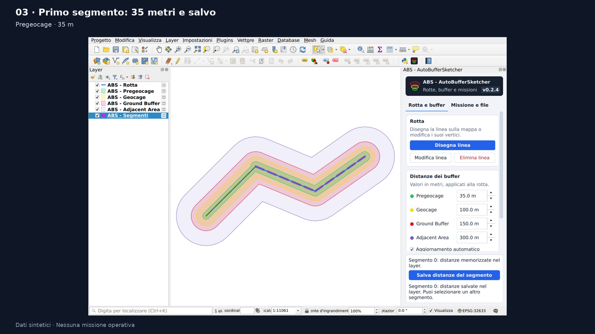
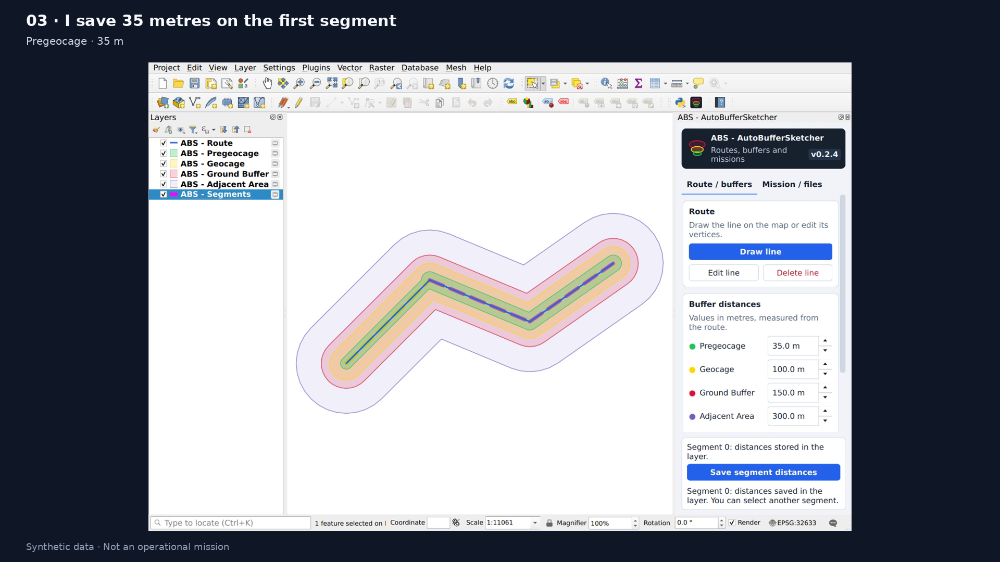

# Demo — ABS - AutoBufferSketcher

[Italiano](#italiano) · [English](#english)

## Italiano

La demo usa la 0.2.4. È valida anche per la 0.2.5: questa versione rinomina soltanto cinque variabili locali, senza modifiche alle funzioni o all’interfaccia.

[**Guarda o scarica il video italiano — 50 secondi**](https://github.com/OnlyPio59/ABS_AutoBufferSketcher/releases/download/v0.2.4/ABS_demo_0.2.4_IT_r1.mp4)

Uso una rotta inventata per mostrare il problema che risolve ABS: modificare la geometria e adattare le distanze dei buffer per tratto, nello stesso pannello QGIS. L’esempio non è una missione operativa.

1. Apro la [rotta sintetica](../examples/synthetic_route.geojson) in un progetto vuoto e seguo la [procedura riproducibile](../examples/README.md). Mostro la versione 0.2.4 nel pannello.
2. Genero le quattro fasce con distanze 50, 100, 150 e 300 metri. Qui uso 300 metri per Adjacent Area per mantenere leggibile l’inquadratura; il default del plugin è 5000.
3. Modifico un vertice e mostro il ricalcolo delle fasce.
4. Attivo le distanze per segmento: imposto Pregeocage a 35 metri sul primo segmento e premo **Salva distanze del segmento**. Sul secondo imposto 70 e salvo. Tornando sul primo ritrovo 35: il salvataggio è indipendente.
5. Esporto GeoPackage e GeoJSON per lo scambio GIS, e il `.plan` dedicato a RigiCloud. Per riprendere il progetto salvo anche i layer persistenti e il progetto QGIS.

Per un video di 45–60 secondi dedico circa 5 secondi all’introduzione, 10 alla geometria, 20 ai due segmenti e 10–15 agli export. Mantengo visibili pannello, versione e valori. Una sequenza di schermate va presentata come tale, senza simularla come registrazione di clic.

Ho verificato il `.plan` nel mio ambiente RigiCloud 1.19.9. Un’eventuale ripresa dell’importazione va fatta in un ambiente autorizzato, senza nomi di clienti, missioni reali o dettagli dell’account. La demo QGIS da sola non documenta l’importazione in RigiCloud.

## English

The demo uses 0.2.4 and also applies to 0.2.5: that version only renames five local variables, with no changes to functionality or the interface.

[**Watch or download the English video — 50 seconds**](https://github.com/OnlyPio59/ABS_AutoBufferSketcher/releases/download/v0.2.4/ABS_demo_0.2.4_EN_r1.mp4)

I use a fictional route to show the problem ABS addresses: editing geometry and adapting buffer distances along individual sections in the same QGIS panel. This example is not an operational mission.

1. Open the [synthetic route](../examples/synthetic_route.geojson) in an empty project and follow the [reproducible procedure](../examples/README.md). Show version 0.2.4 in the panel.
2. Generate the four zones at 50, 100, 150 and 300 metres. Adjacent Area is set to 300 for readable framing; the plugin default remains 5000.
3. Edit a vertex and show the recalculated zones.
4. Enable per-segment distances. Set Pregeocage to 35 metres on the first segment and click **Save segment distances**. Set the second to 70 and save. Return to the first to show that its saved value remains 35.
5. Export GeoPackage and GeoJSON for GIS exchange and the dedicated RigiCloud `.plan`. Save persistent layers and the QGIS project to resume work later.

For a 45–60 second video, allow roughly 5 seconds for the introduction, 10 for geometry, 20 for the two segments and 10–15 for exports. Keep the panel, version and values visible. Present a screenshot sequence as a screenshot sequence rather than a recording of clicks.

I have verified the `.plan` in my RigiCloud 1.19.9 environment. Any import recording should use an authorized environment with no client names, operational missions or account details. The QGIS demo alone does not document a RigiCloud import.
