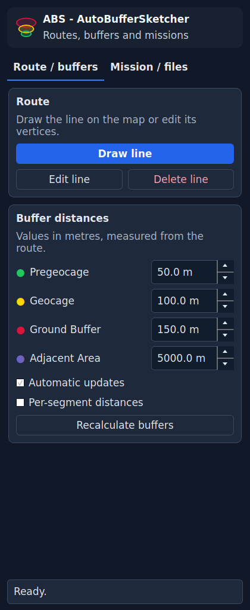
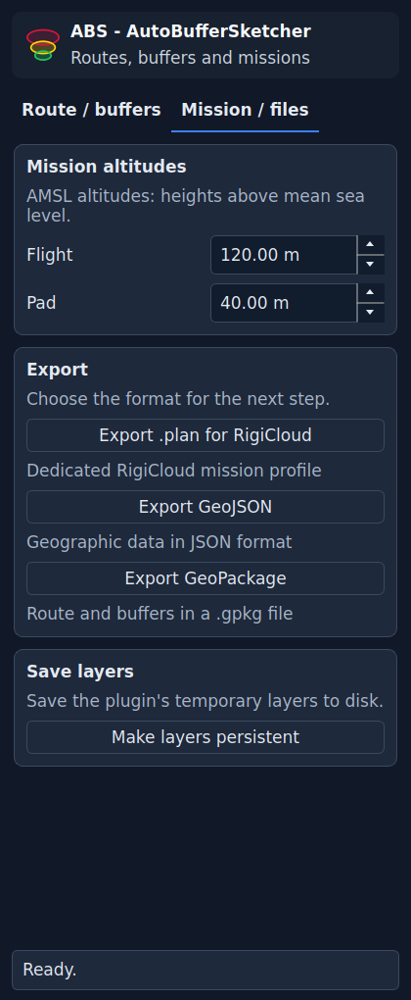

# User guide — ABS - AutoBufferSketcher

[Italiano](USER_GUIDE.md) · [Overview](../README.md) · [Synthetic example — Italian](../examples/README.md)

## Interface language

ABS follows the QGIS interface language. Italian and English are
available, with Italian as fallback. To change it, open **Settings → Options → General**,
choose the interface language and restart QGIS. The released 0.2.0 ZIP retains the
Italian interface. Layer names, fields and exported data remain unchanged.

## Loaded version

The `v…` badge in the header shows the version of the code loaded in QGIS. If the plugin files are updated while QGIS is open, the badge keeps the current session’s version. Save the project and restart QGIS to load the new version. The tooltip explicitly identifies the loaded version.

## The panel

**Route / buffers** contains drawing, editing, distances, segments and recalculation.
**Mission / files** contains altitudes, exports and persistence. The content scrolls
when space is limited; status and segment saving remain in the fixed footer of the
first tab.

The logo always uses a dark background. The rest of the panel follows the QGIS
palette without changing the application's theme.

## Buffer distances

| Zone | Colour | Initial value |
| --- | --- | ---: |
| Pregeocage | Green | 50 m |
| Geocage | Yellow | 100 m |
| Ground Buffer | Red | 150 m |
| Adjacent Area | Purple | 5000 m |

Each distance is measured from the source line; the four distances are not added
together. The plugin does not enforce increasing values. A zero value does not
create a zone with positive area. The fields accept 0–50000 metres with one decimal.

The engine transforms geometries into a local metric UTM CRS for calculation and
returns the results in the route CRS. Define the data CRS correctly; changing the
CRS label alone does not transform incorrect coordinates.

## Drawing and editing

1. Click **Draw line** and add vertices on the map. Right-click to finish, Backspace
   to remove the last vertex, and Esc to cancel drawing.
2. Click **Edit line** to use the QGIS vertex tool. The button becomes **Save changes**;
   click it to finish editing and recalculate.
3. **Delete line** requires confirmation. If several lines exist, select the ones
   to remove before confirming.

With **Automatic updates** enabled, changes to the route and uniform distances
update the buffers. Otherwise use **Recalculate buffers**. In per-segment mode,
apply changed field values with the dedicated save button.

## Per-segment distances

1. Draw or load a route and enable **Per-segment distances**.
2. Select a segment on the map. The panel loads its four distances and identifies it.
3. Change the values. **Unsaved changes** means the fields do not yet match the values
   stored in the layer.
4. Click **Save segment distances** in the footer and wait for confirmation.
5. Select another segment. The previous segment retains its saved values; selecting
   it again restores those values in the fields.

**Apply to all segments** replaces every segment's values with the current values.
If you change the selection before saving, the panel loads the new segment's values;
field changes are not saved automatically when switching segments.

Splitting a segment preserves its values when the geometric match is identifiable.
Merging segments with different distances requires an explicit choice of values or
undoing the edit. Disabling per-segment mode removes its layer from the project
and returns to uniform distances.

## Saving values, layers and the project

These are separate operations:

- **Save segment distances** writes attributes to the current layer. A temporary
  layer stays temporary. If you opened a manual editing session, the plugin does
  not commit the session's other edits on your behalf.
- **Make layers persistent**, in the second tab, saves route, buffers and segments
  to GeoPackage and updates their references in the project. Finish open editing
  sessions first.
- QGIS **Save project** stores file references, plugin mode and parameters. Saving
  the project alone does not make temporary layers persistent.

Unrelated tables in the destination GeoPackage are preserved. A GeoPackage already
open in the project is not replaced by export; choose another file. SQLite `-wal`
and `-shm` files accompanying an open GeoPackage are database service files.

## Mission altitudes

**Flight** and **Pad** are AMSL altitudes, measured above mean sea level. Initial
values are 120 and 40 metres respectively; fields accept 0–5000 metres with two
decimals. These are not AGL heights automatically derived from terrain.

The `.plan` format also contains inherited static exporter parameters. The author has
verified that the exported file works in their RigiCloud 1.19.9 environment. This
does not cover every mission configuration; changing panel altitudes does not
validate a mission.

## Choosing an export

| Format or action | Contents | Use |
| --- | --- | --- |
| Export GeoPackage | Route and four buffers | Deliver a copy of the GIS results. |
| Make layers persistent | Route, buffers and segments | Continue work while retaining per-segment parameters. |
| GeoJSON | Routes, waypoints and buffers in WGS84 | Exchange with GIS tools; preserves separate parts and holes. |
| .plan for RigiCloud | One selected route, buffers and dedicated profile parameters | RigiCloud workflow, within representable limits; a practical check in the author's workflow passed. |

If several routes exist, `.plan` export requires explicitly selecting one route.
The current profile needs at least three vertices and rejects separate parts,
inner rings and other unrepresentable geometries. Files sharing the `.plan`
extension do not necessarily share a schema.

## Common problems

| Situation | Useful check |
| --- | --- |
| A segment's distances appear unchanged | Check the map selection, click Save segment distances and read the confirmation. |
| An action is not visible | Scroll the tab; status and segment saving remain in the footer. |
| Buffers are not updating | Check Automatic updates, click Recalculate buffers and read the status message. |
| CRS or extent error | Check the actual data CRS and regional limits in the README. |
| A reopened project cannot find its layers | Check that layers were made persistent and the GeoPackages were not moved. |
| .plan export is rejected | Check the selected route, vertex count and message about unrepresentable geometries. |

Use the Issues template and a synthetic example for reproducible reports. Include
QGIS/plugin versions, operating system, CRS, buffer mode and the steps performed.

## Which application is the .plan intended for?

**Export .plan for RigiCloud** generates the dedicated profile currently implemented
for that workflow, including a VTOL mission, safety settings and geofences. The author
has verified that the exported file works in their RigiCloud 1.19.9 environment;
this does not validate every possible configuration.

The `.plan` extension alone does not identify a common schema across applications.
For example, [QGroundControl documents its own format](https://docs.qgroundcontrol.com/master/en/qgc-dev-guide/file_formats/plan.html),
which differs from the current ABS profile. An additional exporter would need a
named destination, a schema/version and dedicated import tests. There is no second
generic mission exporter.

GeoJSON and GeoPackage exchange geometries independently of the RigiCloud mission
profile; they are not flight plans executable in every application.
