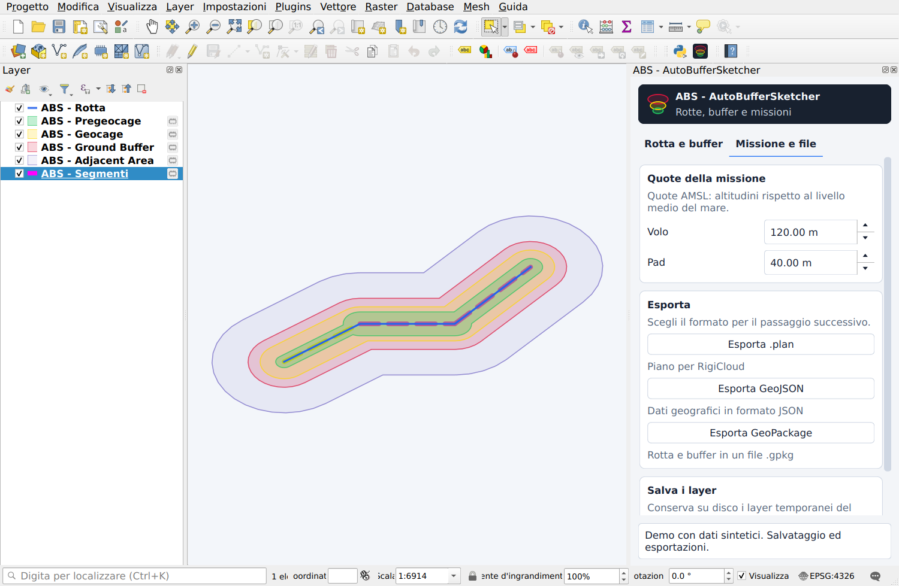

# Guida d’uso — ABS - AutoBufferSketcher

[English](USER_GUIDE.en.md) · [Presentazione](../README.md) · [Esempio sintetico](../examples/README.md)

## Lingua dell’interfaccia

Nel sorgente 0.2.1, ABS segue la lingua impostata in QGIS: italiano e inglese sono disponibili, con italiano come ripiego. Per cambiarla usa **Impostazioni → Opzioni → Generale**, scegli la lingua dell’interfaccia e riavvia QGIS. La release 0.2.0 mantiene l’interfaccia italiana. Nomi dei layer, campi e dati esportati restano invariati.

## Il pannello

**Rotta e buffer** raccoglie disegno, modifica, distanze, segmenti e ricalcolo. **Missione e file** raccoglie quote, esportazioni e persistenza. Il contenuto scorre quando lo spazio è ridotto; messaggio di stato e salvataggio del segmento rimangono nel fondo fisso della prima scheda.

Il logo ha uno sfondo scuro fisso. Il resto del pannello segue la palette di QGIS, senza cambiare il tema dell’applicazione.

## Distanze dei buffer

| Fascia | Colore | Valore iniziale |
| --- | --- | ---: |
| Pregeocage | Verde | 50 m |
| Geocage | Giallo | 100 m |
| Ground Buffer | Rosso | 150 m |
| Adjacent Area | Viola | 5000 m |

Ogni distanza è misurata dalla linea sorgente: le quattro distanze non vengono sommate tra loro. Il plugin non impone un ordine crescente dei valori. Un valore zero non genera una fascia con area positiva. I campi accettano da 0 a 50000 metri con un decimale.

Il motore trasforma le geometrie in un CRS metrico UTM locale per il calcolo e riporta i risultati nel CRS della rotta. Definisci correttamente il CRS dei dati; cambiare soltanto l’etichetta del CRS non trasforma coordinate sbagliate.

## Disegnare e modificare

1. Premi **Disegna linea** e inserisci i vertici sulla mappa. Usa clic destro per completare, Backspace per annullare l’ultimo vertice ed Esc per annullare il disegno.
2. Premi **Modifica linea** per usare lo strumento vertici di QGIS. Il pulsante diventa **Salva modifiche**: premilo per terminare l’editing e ricalcolare.
3. **Elimina linea** richiede una conferma. Se sono presenti più linee, seleziona quelle da eliminare prima di confermare.

Con **Aggiornamento automatico** attivo, le variazioni della rotta e delle distanze uniformi aggiornano i buffer. Con l’opzione disattivata, usa **Ricalcola buffer**. Le modifiche dei campi in modalità segmenti vanno applicate con il pulsante dedicato.

## Distanze diverse per segmento

1. Disegna o carica una rotta e attiva **Distanze diverse per segmento**.
2. Seleziona un segmento sulla mappa. Il pannello carica le sue quattro distanze e indica il segmento corrente.
3. Modifica i valori. La dicitura **modifiche da salvare** segnala che i campi non corrispondono ancora ai valori memorizzati nel layer.
4. Premi **Salva distanze del segmento** nel fondo del pannello e attendi la conferma.
5. Seleziona un altro segmento. Il precedente conserva i valori salvati; tornando su di esso li ritroverai nei campi.

**Applica a tutti i segmenti** sostituisce i valori di tutti i segmenti con quelli correnti. Se cambi selezione prima di salvare, il pannello carica i valori del nuovo segmento: non è previsto il salvataggio automatico dei campi al cambio di selezione.

La divisione di un segmento conserva i valori quando la corrispondenza geometrica è riconoscibile. La fusione di segmenti con distanze differenti richiede una scelta esplicita dei valori o l’annullamento della modifica. Disattivare la modalità segmenti rimuove il relativo layer dal progetto e torna alle distanze uniformi.

## Salvare valori, layer e progetto

Sono operazioni diverse:

- **Salva distanze del segmento** scrive gli attributi nel layer corrente. Un layer temporaneo resta temporaneo. Se hai aperto una sessione di editing manuale sul layer, il plugin non conclude al tuo posto le altre modifiche della sessione.
- **Rendi layer persistenti**, nella seconda scheda, salva su GeoPackage rotta, buffer e segmenti e aggiorna i riferimenti dei layer nel progetto. Termina prima le sessioni di editing aperte.
- **Salva progetto** di QGIS conserva riferimenti ai file, modalità e parametri del plugin. Salvare il progetto da solo non trasforma in persistenti i layer temporanei.

Le tabelle estranee del GeoPackage di destinazione vengono conservate. Un GeoPackage già aperto nel progetto non viene sostituito dall’esportazione: scegli un altro file. I file SQLite `-wal` e `-shm` che possono accompagnare un GeoPackage aperto sono file di servizio del database.

## Quote della missione

**Volo** e **Pad** sono quote AMSL, riferite al livello medio del mare. I valori iniziali sono rispettivamente 120 e 40 metri; l’intervallo dei campi è 0–5000 metri con due decimali. Non sono altezze AGL automaticamente ricavate dal terreno.

Il formato `.plan` contiene anche parametri statici ereditati dall’esportatore. La loro validazione nell’ambiente RigiCloud 1.19.9 è ancora aperta; modificare le quote nel pannello non convalida una missione.

## Scegliere il formato

| Formato o azione | Contenuti | Quando usarlo |
| --- | --- | --- |
| Esporta GeoPackage | Rotta e quattro buffer | Consegnare una copia dei risultati GIS. |
| Rendi layer persistenti | Rotta, buffer e segmenti | Continuare il lavoro conservando i parametri per segmento. |
| GeoJSON | Rotte, waypoint e buffer in WGS84 | Scambio con altri strumenti GIS; conserva parti separate e buchi. |
| .plan per RigiCloud | Una rotta selezionata, buffer e parametri del profilo dedicato | Flusso RigiCloud, nei limiti rappresentabili e con compatibilità ancora da verificare. |

Se ci sono più rotte, l’esportazione `.plan` richiede la selezione esplicita di una sola rotta. Il profilo attuale richiede almeno tre vertici e rifiuta parti separate, anelli interni o altre geometrie non rappresentabili. Non tutti i file con estensione `.plan` usano lo stesso schema.

## Risolvere i problemi più comuni

| Situazione | Controllo utile |
| --- | --- |
| Le distanze di un segmento sembrano non cambiare | Verifica la selezione sulla mappa, premi Salva distanze del segmento e leggi la conferma. |
| Non vedi un’azione nella scheda | Scorri il contenuto; stato e pulsante di salvataggio del segmento restano in basso. |
| I buffer non si aggiornano | Controlla l’opzione automatica, premi Ricalcola e leggi il messaggio di stato. |
| Ricevi un errore sul CRS o sull’estensione | Controlla il CRS reale dei dati e i limiti regionali descritti nel README. |
| Il progetto riaperto non trova i layer | Verifica che siano stati resi persistenti e che i GeoPackage non siano stati spostati. |
| L’export .plan viene rifiutato | Controlla rotta selezionata, numero di vertici e messaggio sulle geometrie non rappresentabili. |

Per una segnalazione riproducibile usa il modello Issues e un esempio sintetico. Indica versione QGIS/plugin, sistema, CRS, modalità dei buffer e passaggi eseguiti.

## A quale applicazione è destinato il .plan?

Il comando **Esporta .plan per RigiCloud** produce il profilo specifico attualmente implementato per quel flusso, con missione VTOL, parametri di sicurezza e geofence. La compatibilità completa con RigiCloud 1.19.9 rimane da validare. Non è una dichiarazione di conformità a un formato universale.

L’estensione `.plan` non identifica da sola uno schema comune a tutte le applicazioni. Per esempio, [QGroundControl documenta un proprio formato](https://docs.qgroundcontrol.com/master/en/qgc-dev-guide/file_formats/plan.html), diverso da quello attuale di ABS. Un eventuale esportatore aggiuntivo dovrà essere identificato con il nome del destinatario, avere una specifica/versione e prove di importazione dedicate. Non è presente un secondo esportatore missione generico.

Per scambiare le geometrie senza vincolarsi al profilo missione RigiCloud, sono disponibili GeoJSON e GeoPackage; questi non equivalgono a un piano di volo eseguibile in qualsiasi software.
